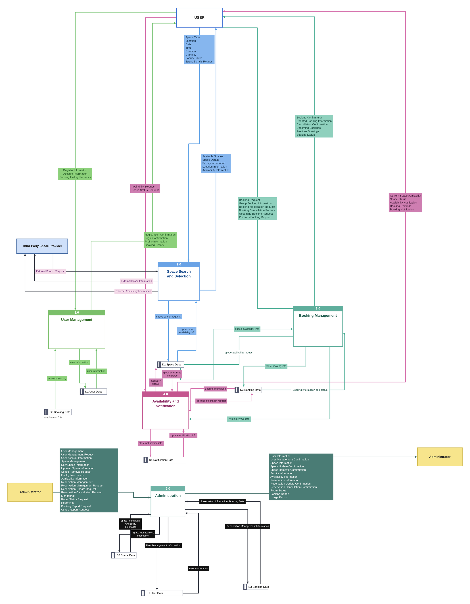

# Level-0 Data Flow Diagram

The Level-0 DFD breaks Process 0 from the Context Diagram into five major processes. It uses the same external entities as the Context Diagram: **User**, **Administrator**, and **Third-Party Space Provider**.

Editable diagram (Creately): https://app.creately.com/d/lNShtZgzeFY/edit

## Major Processes

| No. | Process | Derived from |
|---|---|---|
| P1 | User Management | FR-10, FR-11, FR-13 |
| P2 | Space Search and Selection | FR-01, FR-02, FR-03 |
| P3 | Booking Management | FR-04, FR-05, FR-06, FR-12, FR-13 |
| P4 | Availability and Notifications | FR-05, FR-07, FR-08 |
| P5 | Administration | FR-09, FR-14, FR-15 |

The inputs, outputs, and rules for each process are in [Core_Processes_Matrix.md](../Core_Processes_Matrix.md).

## Data Stores

| ID | Data store | Used by |
|---|---|---|
| D1 | User Data | P1 User Management, P5 Administration |
| D2 | Space Data | P2 Space Search and Selection, P3 Booking Management, P4 Availability and Notifications, P5 Administration |
| D3 | Booking Data | P1 User Management (booking history), P3 Booking Management, P4 Availability and Notifications, P5 Administration |
| D4 | Notification Data | P4 Availability and Notifications |

D3 appears more than once in the diagram to keep the lines readable; it is the same data store each time.

## Internal Data Flows

| From | To | Data flow |
|---|---|---|
| P1 | D1 | User Information |
| D1 | P1 | User Information |
| D3 | P1 | Booking History |
| P2 | D2 | Space Search Request |
| D2 | P2 | Space Info, Availability Info |
| D2 | P3 | Space Availability Info |
| P3 | D2 | Space Availability Request |
| P3 | D3 | Store Booking Info |
| D3 | P3 | Booking Information and Status |
| P3 | P4 | Availability Update |
| P4 | D2 | Availability Update |
| D2 | P4 | Space Availability and Status |
| P4 | D3 | Booking Information Request |
| D3 | P4 | Booking Information |
| P4 | D4 | Store Notification Info |
| D4 | P4 | Update Notification Info |
| P5 | D1 | User Management Information |
| D1 | P5 | User Information |
| P5 | D2 | Space Management Information |
| D2 | P5 | Space Information, Availability Information |
| P5 | D3 | Reservation Management Information |
| D3 | P5 | Reservation Information, Booking Data |

## Third-Party Space Provider Flows

| From | To | Data flow |
|---|---|---|
| Third-Party Space Provider | P2 | External Search Request |
| P2 | Third-Party Space Provider | External Space Information |
| P2 | Third-Party Space Provider | External Availability Information |
