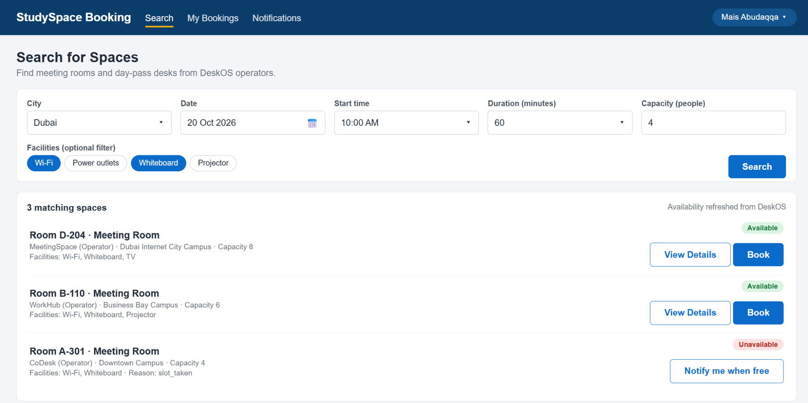
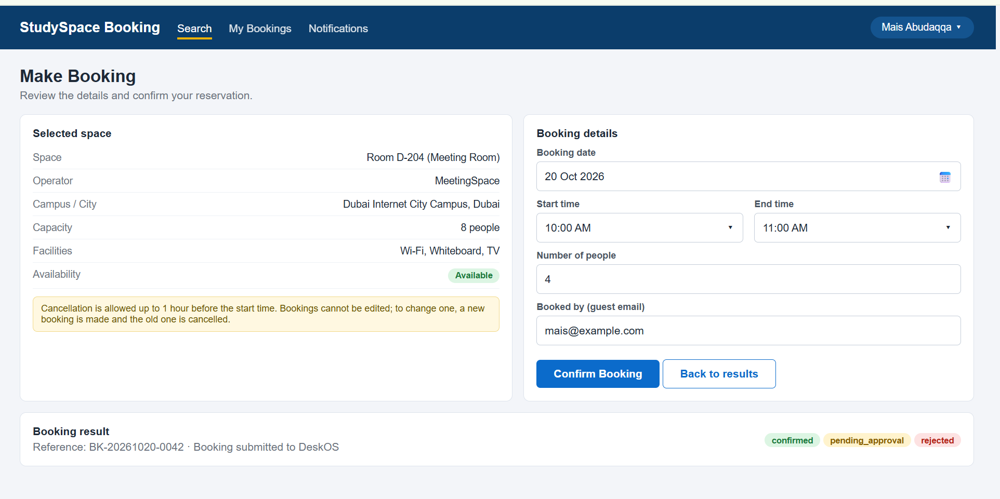
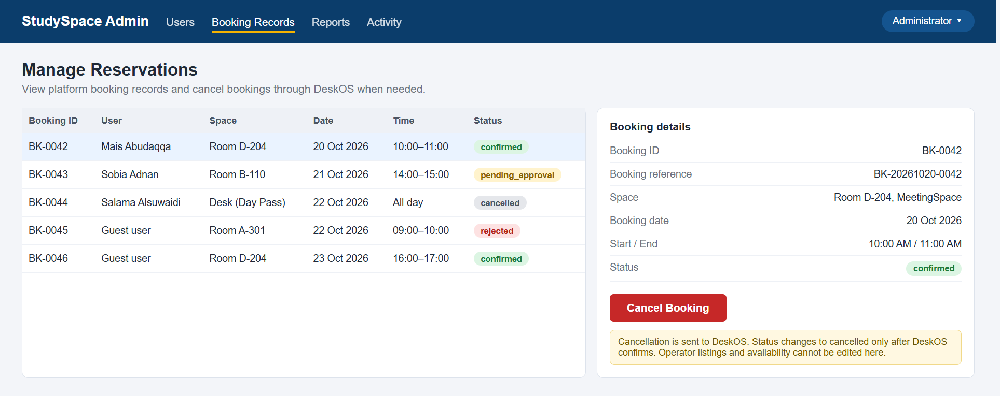

# 9. GUI Prototypes

The three GUI prototypes of the main interfaces of the system covers the
three major use cases modelled in the sequence and activity diagrams
(UC-01 Search for Spaces, UC-04 Make Booking, and UC-13 Manage
Reservations). The fields shown on each screen match the attributes of
the consolidated class diagram (Figure 6.1), and the user actions follow
the steps of the related use case.

## 9.1. Search for Spaces Screen

**Figure 9.1:** Search for Spaces Screen

The user selects a city, date, start time, duration, and capacity, and
may tick optional facilities such as Wi-Fi or whiteboard. These fields
correspond to the SearchCriteria attributes (city, date, startTime,
duration, capacity, selectedFacilities). After pressing Search, the
system validates the criteria and retrieves the campuses and inventory
from DeskOS.

Each result shows the space name, the operator's name, the campus
(Location), its capacity and facilities (Space and Facility), and its
availability status (Availability). The user can open the space details,
book an available space, or request a notification for an unavailable
one (UC-08).

## 9.2. Make Booking Screen

**Figure 9.2:** Make Booking Screen

After choosing a space, the user reviews its details and enters the
booking date, start time, end time, and number of people, which match
the Booking attributes (bookingDate, startTime, endTime). The guest
email is required because DeskOS bookings are made in the user's name.

When the user presses Confirm Booking, the system checks the
availability, submits the booking to DeskOS, and shows the booking
reference and the status returned by DeskOS (confirmed,
pending_approval, or rejected). The screen also reminds the user that a
booking cannot be edited and that cancellation is allowed up to one hour
before the start time.

## 9.3. Manage Reservations Screen

**Figure 9.3:** Manage Reservations Screen

The administrator opens the booking records and sees a list with the
booking ID, user, space, date, time, and status. Selecting a row shows
the booking details (bookingId, bookingReference, bookingDate,
startTime, endTime, status) on the right.

The Cancel Booking button is used only for bookings that are confirmed
or pending_approval. The cancellation is sent to DeskOS, and the status
changes to cancelled only after DeskOS confirms. The screen does not
allow the administrator to edit the operators' spaces or availability.
