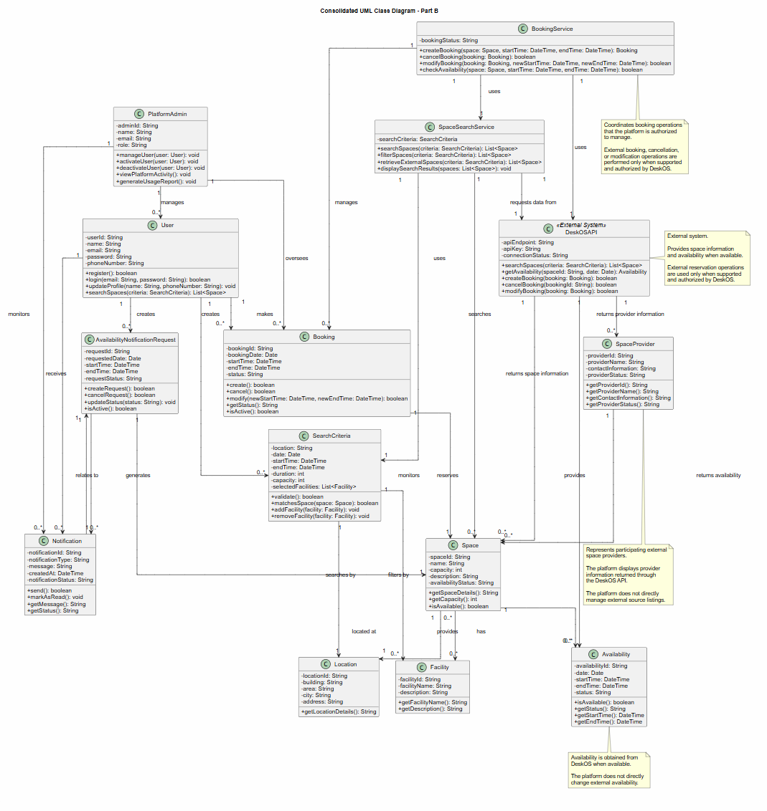

# Consolidated UML Class Diagram

One class diagram for the whole system, integrated from the three [individual models](../Individual_Models/README.md). Integration decisions are recorded in [Integration_Notes.md](../Integration_Notes.md).

## Classes

User, PlatformAdmin, Space, Location, Facility, SearchCriteria, Booking, Availability, AvailabilityNotificationRequest, Notification, SpaceProvider, SpaceSearchService, BookingService, DeskOSAPI `«External System»`.

## Main Associations

| From | Association | To |
|---|---|---|
| PlatformAdmin | manages | User |
| PlatformAdmin | oversees | Booking |
| PlatformAdmin | monitors | Notification |
| User | makes | Booking |
| User | creates | SearchCriteria |
| User | creates | AvailabilityNotificationRequest |
| User | receives | Notification |
| Booking | reserves | Space |
| Space | located at | Location |
| Space | provides | Facility |
| Space | has | Availability |
| SearchCriteria | searches by | Location |
| SearchCriteria | filters by | Facility |
| AvailabilityNotificationRequest | monitors | Space |
| AvailabilityNotificationRequest | generates | Notification |
| Notification | relates to | AvailabilityNotificationRequest |
| SpaceSearchService | uses | SearchCriteria |
| SpaceSearchService | searches | Space |
| SpaceSearchService | requests data from | DeskOSAPI |
| BookingService | uses | SpaceSearchService |
| BookingService | uses | DeskOSAPI |
| BookingService | manages | Booking |
| DeskOSAPI | returns space information | Space |
| DeskOSAPI | returns availability | Availability |
| DeskOSAPI | returns provider information | SpaceProvider |
| SpaceProvider | provides | Space |

Multiplicities for each association are shown on the diagram.

## Notes on the Diagram

- BookingService coordinates booking operations the platform is authorized to manage. External booking, cancellation, and modification operations are performed only when supported and authorized by DeskOS.
- DeskOSAPI is an external system that provides space information and availability when available.
- SpaceProvider represents participating external providers; the platform displays provider information returned through DeskOS and does not directly manage external source listings.
- Availability is obtained from DeskOS when available; the platform does not directly change external availability.
