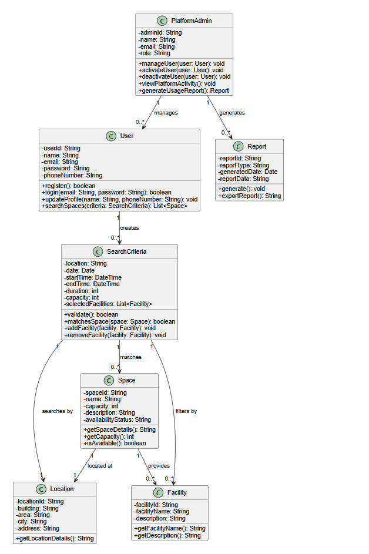
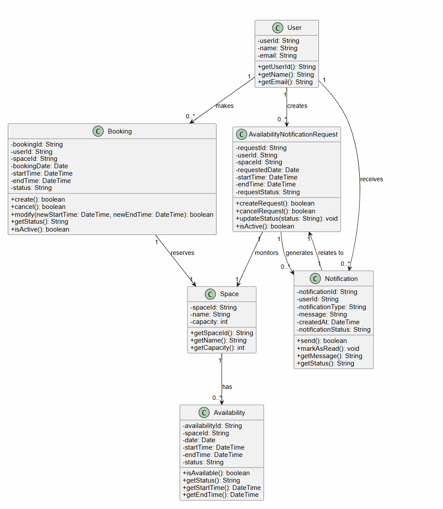
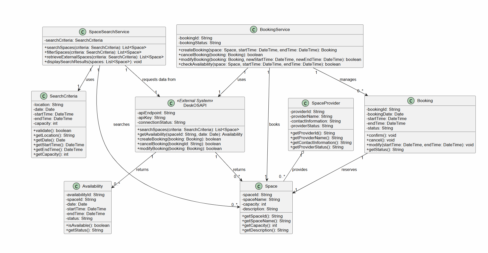

# Individual UML Class Diagrams

Each member modeled the part of the system assigned to them before the team integrated the models. Class responsibilities are listed in the [Class Inventory](../Class_Inventory.md).

## Sobia Adnan – g00100257

Users, administration, spaces, and search: PlatformAdmin, User, Report, SearchCriteria, Space, Location, Facility.

## Salama Alsuwaidi – g00099875

Bookings, availability, and notifications: User, Booking, Space, Availability, AvailabilityNotificationRequest, Notification.

## Mais Abudaqqa – g00099729

Services and the external DeskOS integration: SpaceSearchService, BookingService, DeskOSAPI, SpaceProvider, SearchCriteria, Space, Booking, Availability.

