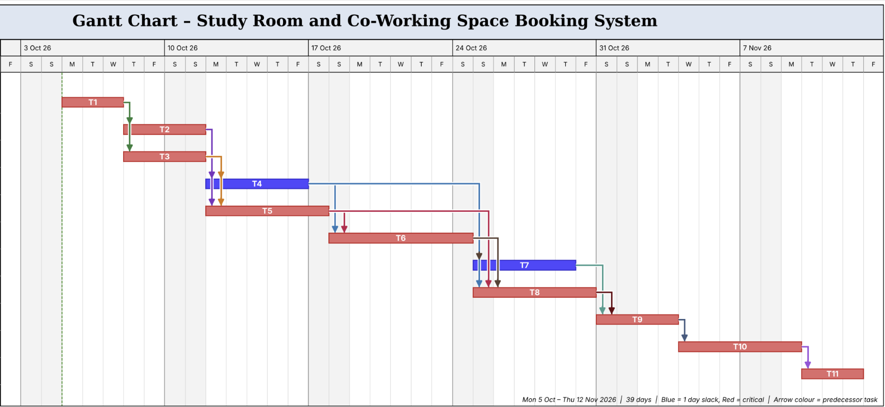

# Exercise 5: Gantt Chart

The tasks are the same as in the [WBS](../WBS.md). The project starts on Monday 5 October 2026 and ends on Thursday 12 November 2026 (39 days).

Red tasks are critical. Blue tasks (T4 and T7) have 1 day of slack.
