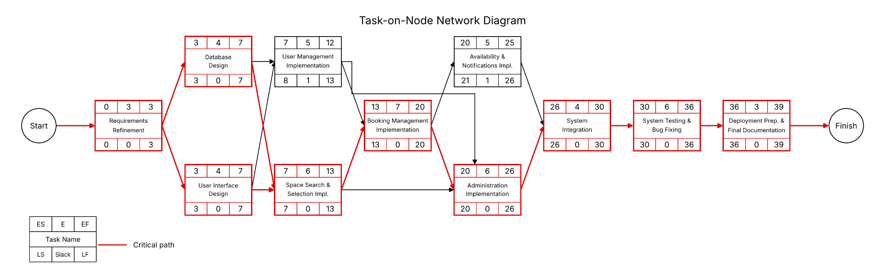
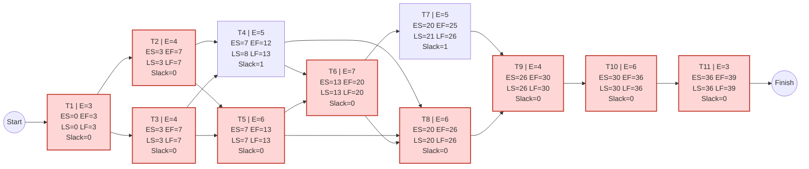

# Network-Based Schedule (Task-on-Node)

Each node shows the Task ID, Expected Time (E), ES, EF, LS, LF, and Slack. Critical tasks (Slack = 0) are highlighted.

## Calculations

**Forward pass** (ES = largest EF of all predecessors, EF = ES + E)

| Task | Predecessors | ES | EF = ES + E |
|---|---|---|---|
| T1 | — | 0 | 0 + 3 = 3 |
| T2 | T1 | 3 | 3 + 4 = 7 |
| T3 | T1 | 3 | 3 + 4 = 7 |
| T4 | T2, T3 | max(7, 7) = 7 | 7 + 5 = 12 |
| T5 | T2, T3 | max(7, 7) = 7 | 7 + 6 = 13 |
| T6 | T4, T5 | max(12, 13) = 13 | 13 + 7 = 20 |
| T7 | T6 | 20 | 20 + 5 = 25 |
| T8 | T4, T5, T6 | max(12, 13, 20) = 20 | 20 + 6 = 26 |
| T9 | T7, T8 | max(25, 26) = 26 | 26 + 4 = 30 |
| T10 | T9 | 30 | 30 + 6 = 36 |
| T11 | T10 | 36 | 36 + 3 = 39 |

**Backward pass** (LF = smallest LS of all successors, LS = LF − E), starting from LF(T11) = 39

| Task | Successors | LF | LS = LF − E |
|---|---|---|---|
| T11 | — | 39 | 39 − 3 = 36 |
| T10 | T11 | 36 | 36 − 6 = 30 |
| T9 | T10 | 30 | 30 − 4 = 26 |
| T8 | T9 | 26 | 26 − 6 = 20 |
| T7 | T9 | 26 | 26 − 5 = 21 |
| T6 | T7, T8 | min(21, 20) = 20 | 20 − 7 = 13 |
| T5 | T6, T8 | min(13, 20) = 13 | 13 − 6 = 7 |
| T4 | T6, T8 | min(13, 20) = 13 | 13 − 5 = 8 |
| T3 | T4, T5 | min(8, 7) = 7 | 7 − 4 = 3 |
| T2 | T4, T5 | min(8, 7) = 7 | 7 − 4 = 3 |
| T1 | T2, T3 | min(3, 3) = 3 | 3 − 3 = 0 |

**Summary** (Slack = LS − ES = LF − EF)

| Task | E | ES | EF | LS | LF | Slack | Critical? |
|---|---|---|---|---|---|---|---|
| T1 | 3 | 0 | 3 | 0 | 3 | 0 | Yes |
| T2 | 4 | 3 | 7 | 3 | 7 | 0 | Yes |
| T3 | 4 | 3 | 7 | 3 | 7 | 0 | Yes |
| T4 | 5 | 7 | 12 | 8 | 13 | 1 | No |
| T5 | 6 | 7 | 13 | 7 | 13 | 0 | Yes |
| T6 | 7 | 13 | 20 | 13 | 20 | 0 | Yes |
| T7 | 5 | 20 | 25 | 21 | 26 | 1 | No |
| T8 | 6 | 20 | 26 | 20 | 26 | 0 | Yes |
| T9 | 4 | 26 | 30 | 26 | 30 | 0 | Yes |
| T10 | 6 | 30 | 36 | 30 | 36 | 0 | Yes |
| T11 | 3 | 36 | 39 | 36 | 39 | 0 | Yes |
