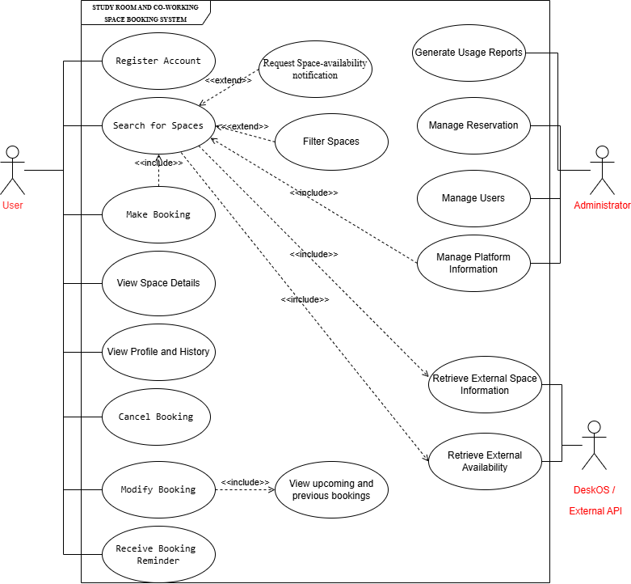

# Overall UML Use Case Diagram

Prepared by Mais Abudaqqa (g00099729) from the team's consolidated use cases in [Use_Cases.md](../Use_Cases.md).

## Actors and Associations

| Actor | Associated use cases |
|---|---|
| User | Register Account, Search for Spaces, Make Booking, View Space Details, View Profile and History, Cancel Booking, Modify Booking, Receive Booking Reminder |
| Administrator | Generate Usage Reports, Manage Reservations, Manage Users, Manage Platform Information |
| DeskOS / External API | Retrieve External Space Information, Retrieve External Availability |

## Relationships Shown

| Relationship ID | Relationship in the diagram |
|---|---|
| R-01 | Make Booking `<<include>>` Search for Spaces |
| R-02 | Filter Spaces `<<extend>>` Search for Spaces |
| R-03 | Modify Booking `<<include>>` View Upcoming and Previous Bookings |
| R-05 | Request Space-Availability Notification `<<extend>>` Search for Spaces |
| R-06 | Search for Spaces `<<include>>` Retrieve External Space Information |
| R-07 | Search for Spaces `<<include>>` Retrieve External Availability |
